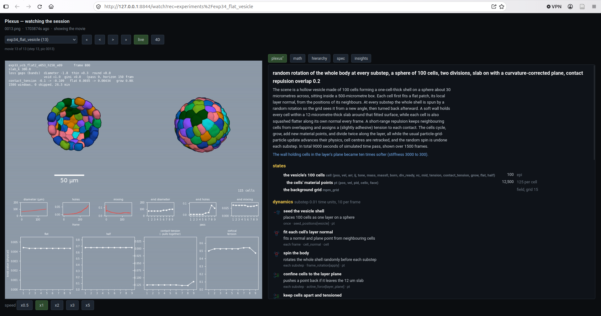

# PLEXUS


PLEXUS represents a cell tissue as a dynamical system composed of graphs, states, coupling relationships, and differentiable functions. We define the system at time $t$ as:

$$
\mathcal{D}(t) = (\mathcal{G}(t), \mathbf{X}(t), \mathcal{F}, C(t))
$$

where:

- $\mathcal{G}(t) = \{G_1(t), \ldots, G_n(t)\}$ is a collection of graphs.
- $\mathbf{X}(t)$ is the collection of states associated with graph elements.
- $\mathcal{F} = \{f_1, \ldots, f_m\}$ is a collection of functions governing the system dynamics.
- $C(t)$ describes the coupling relationships between graphs.

Graphs can be coupled through three types of relationships:
1. **Cross-graph edges:** Edges connecting nodes belonging to different graphs.
2. **Shared nodes:** Nodes belonging to multiple graphs.
3. **Supernodes:** Nodes containing an entire graph or subgraph.
 
Each function acts on subsets of states, graphs, and coupling relationships, and produces a state increment:

$$\Delta X_i = f_i(X_i, G_i, C_i; \theta_i)$$

where:
- $X_i \subseteq \mathbf{X}$ is the subset of states accessed by the function.
- $G_i \subseteq \mathcal{G}$ is the subset of graphs involved.
- $C_i \subseteq C$ is the subset of coupling relationships involved.
- $\theta_i$ denotes the learnable parameters of the function.
  
The global state increment is obtained by summing the contributions of all functions:

$$
\Delta \mathbf{X} = \sum_{i=1}^{m} \Delta X_i
$$

The system evolves through Euler integration:

$$
\mathbf{X}(t+\Delta t) =
\mathbf{X}(t) +
\Delta t \sum_{i=1}^{m}
f_i(X_i,G_i,C_i;\theta_i)
$$

If the individual functions are differentiable, their sum and the resulting Euler evolution map are also differentiable, provided the graph topology and coupling structure are fixed during the differentiation step. This allows the learnable parameters of individual functions to be optimized jointly against target trajectories or energy functions using gradient-based optimization.
Graph structures and coupling relationships can evolve during simulation. In particular, cells are represented as supernodes containing graphs of material points or vertices. Cell growth, division, and death can change graph membership and topology without changing the dimensions of the underlying state tensors. This is achieved using a fixed reservoir of material points or vertices, with active elements changing over time. Cell division, for example, partitions the parent cell's material points between its two daughter cells, preserving the underlying state tensor dimensions.

## Installation

```bash
conda env create -f envs/environment.linux.yaml   # or envs/environment.mac.yaml
conda activate plexus
```

`environment.linux.yaml` is the environment the runs were made in (NVIDIA GPU, CUDA 12.8); `environment.mac.yaml` has the same packages unpinned and runs the watcher and the specs, not the Warp scenes of exp09 and exp10.

## Run

```bash
python Plexus_Main.py -o generate tissue/exp34_ucb_flat_e000_h150_e07 --output_root <data root>   # run one spec of config/
```

Open the watcher in a browser with `python Plexus_gui.py` (it opens http://127.0.0.1:8799/watch); it shows the records of `experiments/`, one at a time (`?rec=experiments/<name>`).



To start a new experiment, follow [`experiments/INSTRUCTION.md`](experiments/INSTRUCTION.md).
