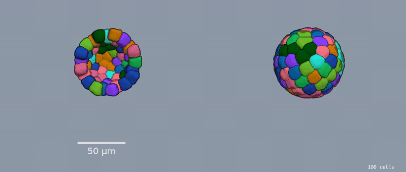

# PLEXUS

A differentiable cell tissue computation



```bash
python Plexus_Main.py -o generate tissue/exp33_ucb_flat_e000_h150_e07 --output_root <data root>   # run one spec of config/
```

The watcher shows the records of `experiments/`, one at a time (`?rec=experiments/<name>`).

To start a new experiment, follow [`experiments/INSTRUCTION.md`](experiments/INSTRUCTION.md).
